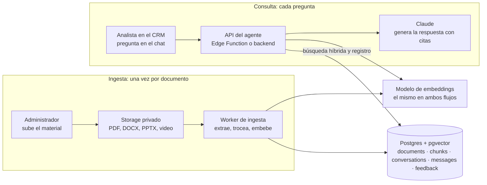
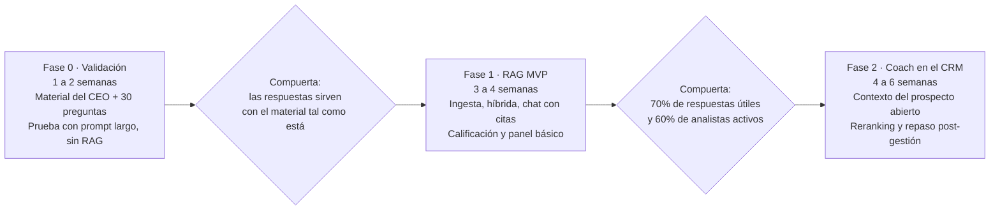

# Agente Coach Comercial — PRD y TRD

Fecha: 2026-11-05 · Autor: Miguel (Avanza Digital) · Estado: fase de exploración

Documento editable: https://claude.ai/artifact/DWLgUGdHYzQgnTFZp6vBwb

---

## Resumen y recomendación de abordaje

Recomendación: sí es un RAG sobre Postgres + pgvector, pero no empieces construyendo el RAG. Empieza validando valor con el material real y 30 preguntas reales de los analistas; el RAG se construye en la fase 1 cuando ya sabes qué preguntan y qué respuesta esperan.

Por qué pgvector y no una base vectorial aparte: el volumen es pequeño (decenas de libros y capacitaciones, no millones de documentos). pgvector dentro del mismo Postgres del CRM evita un servicio más, permite filtrar por metadatos con SQL normal y combinar búsqueda semántica con búsqueda por palabras clave en una sola consulta. Una base vectorial dedicada (Pinecone, Qdrant, Weaviate) solo se justifica arriba de varios millones de vectores o con latencias muy exigentes.

El abordaje en tres pasos:

1. **Fase 0 — Validación (1 a 2 semanas):** recibir el material del CEO, armar un set de 30 preguntas reales con respuesta esperada, y probar la calidad de respuesta con un prompt largo (todo el material en contexto) antes de escribir infraestructura. Si aquí las respuestas no sirven, el problema es el material, no la tecnología.
2. **Fase 1 — RAG MVP (3 a 4 semanas):** ingesta a pgvector, búsqueda híbrida, respuestas con citas a la fuente, chat simple para analistas, botón de "me sirvió / no me sirvió".
3. **Fase 2 — Coach dentro del CRM (4 a 6 semanas):** el agente ve el prospecto que el analista tiene abierto (etapa, objeciones registradas, historial) y responde con ese contexto. Aquí deja de ser un buscador de libros y pasa a ser un entrenador.

Decisiones que ya se pueden tomar: Postgres + pgvector (en Supabase si el CRM ya corre ahí), embeddings multilingües (el material está en español), búsqueda híbrida desde el día uno, y toda respuesta con cita a la fuente para que el analista pueda verificar.

---

# PRD

## Problema, objetivo y usuarios

**Problema:** el analista tiene una duda en medio de una gestión (cómo responder una objeción, cómo cerrar, qué decir ante una pregunta técnica) y hoy la resuelve de memoria, preguntando a un compañero o buscando en el material de capacitación. La respuesta llega tarde o no llega, y la calidad depende de quién esté disponible.

**Objetivo:** que cada analista tenga a mano la respuesta que daría el mejor vendedor de la empresa, basada en las capacitaciones y libros que el CEO ya validó, en menos de 30 segundos y con la fuente visible.

| Usuario | Qué necesita | Cómo lo usa |
| --- | --- | --- |
| Analista / vendedor | Respuesta rápida y accionable a una duda comercial concreta | Chat desde el CRM, durante o después de una gestión |
| CEO / líder comercial | Que el agente responda según su metodología, no genérico | Sube y aprueba el material; revisa respuestas mal calificadas |
| Miguel / producto | Saber si el agente sirve y qué preguntan los analistas | Panel de uso, calificaciones y preguntas sin respuesta |

## Casos de uso

Los cuatro primeros son el MVP; los dos últimos necesitan el contexto del CRM (fase 2).

| # | Caso de uso | Ejemplo de pregunta del analista | Respuesta esperada |
| --- | --- | --- | --- |
| 1 | Manejo de objeciones | "El cliente dice que está muy caro, ¿qué le digo?" | Técnica recomendada por el material + 2 o 3 frases listas para usar + fuente |
| 2 | Técnicas de cierre | "Ya le mostré todo y no se decide, ¿cómo cierro?" | Qué cierre aplica según la situación y cómo ejecutarlo |
| 3 | Preguntas técnicas del producto | "¿Qué le respondo si pregunta por X?" | Respuesta validada desde el material de producto, sin inventar |
| 4 | Comunicación y redacción | "Ayúdame a redactar el seguimiento por WhatsApp" | Mensaje en el tono de la empresa según la capacitación |
| 5 | Coaching con contexto del prospecto | "¿Qué hago con este cliente?" (con el prospecto abierto) | Diagnóstico de la etapa y siguiente paso sugerido |
| 6 | Repaso post-gestión | "Esto fue lo que pasó en la llamada, ¿qué pude hacer mejor?" | Retroalimentación contra la metodología |

Fuera de los casos de uso: el agente no habla con el cliente final, no toma decisiones de descuento ni compromisos comerciales, y no reemplaza la capacitación presencial.

## Alcance del MVP y fuera de alcance

El MVP es un chat que responde preguntas comerciales citando el material del CEO. Nada más.

Dentro del MVP:

- Carga de material por un administrador: PDF, DOCX, PPTX, transcripciones de video (texto) y notas.
- Chat en español, una conversación por sesión, con historial corto.
- Cada respuesta cita la fuente (documento + sección o página) y el analista puede abrirla.
- Si el material no cubre la pregunta, el agente lo dice en vez de inventar.
- Calificación por respuesta (útil / no útil) y comentario opcional.
- Panel básico: preguntas más frecuentes, respuestas mal calificadas, preguntas sin cobertura.

Fuera de alcance del MVP (fase 2 en adelante):

- Contexto del prospecto desde el CRM (etapa, objeciones, historial).
- Coaching proactivo (el agente sugiere sin que le pregunten).
- Audio en tiempo real durante llamadas.
- Integración con WhatsApp o canales externos.
- Roles y permisos por equipo (en el MVP todos ven todo el material).
- Entrenamiento o fine-tuning de modelos: no hace falta, el RAG con buen material resuelve el caso.

## Requisitos funcionales y no funcionales

| ID | Requisito | Prioridad |
| --- | --- | --- |
| RF-01 | El administrador sube documentos y el sistema los procesa sin intervención manual | Debe |
| RF-02 | El analista pregunta en lenguaje natural en español y recibe respuesta con citas | Debe |
| RF-03 | Cada cita enlaza al fragmento original (documento, página o sección) | Debe |
| RF-04 | Si no hay cobertura en el material, el agente responde "no está en el material" y sugiere a quién preguntar | Debe |
| RF-05 | El analista califica la respuesta y puede dejar comentario | Debe |
| RF-06 | El administrador ve preguntas frecuentes, mal calificadas y sin cobertura | Debe |
| RF-07 | El administrador puede desactivar o reemplazar un documento y el índice se actualiza | Debe |
| RF-08 | El agente respeta un prompt de sistema con la metodología y tono definidos por el CEO | Debe |
| RF-09 | El analista puede seguir la conversación con preguntas de continuación | Debería |
| RF-10 | El agente recibe el contexto del prospecto abierto en el CRM | Fase 2 |

No funcionales:

- Latencia: primera palabra de la respuesta en menos de 3 segundos; respuesta completa en menos de 15.
- Disponibilidad: la del CRM; el agente no debe tumbar el CRM si falla (servicio separado o función aislada).
- Privacidad: el material del CEO no sale a servicios que lo usen para entrenar modelos; proveedores con política de no entrenamiento.
- Trazabilidad: cada respuesta guarda qué fragmentos se usaron y con qué prompt, para poder auditar y mejorar.
- Costo: objetivo menor a 0.05 USD por pregunta en promedio (ver sección de costos).

## Métricas de éxito

La métrica que decide si el MVP sigue: 70% o más de las respuestas calificadas como útiles después de 4 semanas de uso real.

| Métrica | Meta MVP | Cómo se mide |
| --- | --- | --- |
| Respuestas útiles | ≥ 70% de las calificadas | Botón útil / no útil |
| Adopción | ≥ 60% de los analistas lo usan cada semana | Usuarios activos semanales |
| Preguntas por analista | ≥ 5 por semana | Conteo en base de datos |
| Precisión sobre el set de prueba | ≥ 80% correctas en las 30 preguntas de referencia | Evaluación manual del CEO o líder comercial, cada vez que cambia el material o el prompt |
| Preguntas sin cobertura | Tendencia a la baja mes a mes | Respuestas marcadas "no está en el material" |
| Costo por pregunta | < 0.05 USD | Tokens consumidos por respuesta |

Métrica de negocio (fase 2, cuando hay contexto del CRM): tasa de cierre y tiempo de ciclo de los analistas que usan el agente contra los que no.

---

# TRD

## Arquitectura propuesta

Un solo Postgres con pgvector sirve a los dos flujos: la ingesta escribe fragmentos y vectores, la consulta los lee. No hay base vectorial aparte ni servicio adicional que mantener.



La ingesta corre en segundo plano cuando el administrador sube material; la consulta corre en cada pregunta y pasa por la API, que busca en Postgres y genera con Claude.

| Componente | Opción recomendada | Alternativa | Por qué |
| --- | --- | --- | --- |
| Base de datos | Postgres + pgvector (Supabase si el CRM ya corre ahí) | Postgres propio en el VPS con pgvector | Mismo motor que el CRM, RLS y auth ya resueltos, pgvector viene instalado |
| Storage del material | Supabase Storage, bucket privado | S3 compatible | Integrado con la misma auth |
| Worker de ingesta | Script Python en el VPS (cola simple en Postgres) | Edge Function con límite de tiempo | Procesar un libro tarda minutos; un worker no tiene límite de tiempo |
| Embeddings | Voyage `voyage-3` o `voyage-multilingual-2` (1024 dim) | OpenAI `text-embedding-3-small` (1536 dim) | Buen desempeño en español, costo bajo; Voyage es el proveedor que Anthropic recomienda |
| Generación | Claude Sonnet (calidad) con Haiku para reformulación y contexto de fragmentos | Un solo modelo | Separar tareas baratas de la respuesta final baja el costo por pregunta |
| Reranking (fase 2) | Voyage rerank o Cohere rerank | Sin reranking | Sube precisión de los 8 fragmentos finales |
| API del agente | Supabase Edge Function con streaming | Endpoint en el backend del CRM | Cerca de la base, llaves en servidor, se despliega aparte del CRM |
| Frontend | Panel de chat dentro del CRM | Web aparte | La adopción depende de que esté donde el analista ya trabaja |
| Orquestación | Código propio (TypeScript o Python), sin framework | LangChain / LlamaIndex | El pipeline tiene 7 pasos; un framework agrega capas que luego hay que depurar |

La dimensión del vector se fija al elegir el modelo de embeddings y no se cambia después sin reindexar todo; elegirlo en la fase 0.

## Pipeline de ingesta

La ingesta corre una vez por documento (y otra vez si el documento cambia). Es un proceso en segundo plano, no en la petición del usuario.

1. **Subida:** el administrador sube el archivo a storage (bucket privado) y se registra en la tabla `documents` con título, tipo, autor y estado `pending`.
2. **Extracción de texto:** PDF con `pdfplumber` o `pymupdf`; DOCX con `python-docx`; PPTX con `python-pptx`; videos de capacitación se transcriben antes (Whisper) y entran como texto. PDFs escaneados pasan por OCR (Tesseract) y se marcan para revisión.
3. **Limpieza y estructura:** quitar encabezados y pies repetidos, conservar títulos de capítulo y sección como metadatos del fragmento.
4. **Chunking:** fragmentos de 400 a 800 tokens respetando párrafos y secciones, con solapamiento de 10 a 15%. Cada fragmento guarda documento, capítulo, página y posición.
5. **Contexto por fragmento (recomendado):** antes de generar el embedding, un modelo barato escribe 1 o 2 frases que sitúan el fragmento dentro del documento ("Este fragmento del capítulo 4 de X trata la objeción de precio…"). Se antepone al texto del fragmento. Esto mejora el recall de forma notable en material largo como libros.
6. **Embeddings:** un vector por fragmento con un modelo multilingüe. Se procesan en lotes de 50 a 100 fragmentos.
7. **Indexación:** se inserta en `chunks` el texto, el contexto, los metadatos, el vector (`vector(1024)` o `vector(1536)` según el modelo) y el `tsvector` en español para búsqueda por palabras clave.
8. **Estado:** el documento pasa a `ready`; si falla algún paso, a `error` con el motivo visible para el administrador.

Reemplazar un documento = marcar la versión anterior como inactiva y procesar la nueva; los fragmentos inactivos no se consultan pero se conservan para auditoría.

Volumen de referencia: un libro de 300 páginas produce entre 300 y 500 fragmentos. Con 50 libros y capacitaciones el índice tiene menos de 30,000 vectores, lejos del límite cómodo de pgvector.

## Pipeline de consulta

Cada pregunta del analista recorre estos pasos; el objetivo es entregar al modelo los 5 a 8 fragmentos correctos, no 50 parecidos.

1. **Reformulación:** si hay historial, un modelo barato reescribe la pregunta como pregunta independiente ("¿y si dice que no tiene tiempo?" pasa a "¿cómo manejar la objeción de falta de tiempo?").
2. **Embedding de la pregunta** con el mismo modelo usado en la ingesta.
3. **Búsqueda híbrida** en una sola consulta SQL: los 20 fragmentos más cercanos por coseno en pgvector + los 20 mejores por `tsvector` en español, combinados con Reciprocal Rank Fusion. La búsqueda por palabras clave rescata términos exactos (nombres de técnicas, productos, siglas) que el vector a veces pierde.
4. **Reranking** (opcional en MVP, recomendado en fase 2): un modelo de reranking reordena esos 20 a 40 candidatos y se conservan los 6 a 8 mejores.
5. **Generación:** Claude recibe el prompt de sistema (rol de entrenador comercial, metodología del CEO, tono, regla de no inventar), los fragmentos con su referencia y la pregunta. Responde en streaming con citas numeradas.
6. **Verificación de cobertura:** si la similitud máxima queda bajo un umbral (calibrado con el set de prueba) el agente responde que el material no lo cubre.
7. **Registro:** se guarda pregunta, fragmentos usados, respuesta, modelo, tokens y latencia en `conversations` y `messages`; la calificación del analista se agrega después.

Estructura de la respuesta para el analista: diagnóstico de la situación en 1 o 2 frases, qué hacer (técnica), cómo decirlo (2 o 3 frases listas), y fuentes. Esta estructura va en el prompt de sistema, no se deja al modelo.

## Modelo de datos

Cinco tablas en el mismo Postgres del CRM, esquema `coach`. La dimensión del vector depende del modelo de embeddings elegido; aquí se usa 1024 como ejemplo.

```sql
create extension if not exists vector;
create schema if not exists coach;

create table coach.documents (
  id uuid primary key default gen_random_uuid(),
  title text not null,
  kind text not null check (kind in ('libro','capacitacion','producto','guion','otro')),
  author text,
  storage_path text not null,
  version int not null default 1,
  is_active boolean not null default true,
  status text not null default 'pending' check (status in ('pending','processing','ready','error')),
  error_message text,
  uploaded_by uuid references auth.users(id),
  created_at timestamptz not null default now()
);

create table coach.chunks (
  id bigserial primary key,
  document_id uuid not null references coach.documents(id) on delete cascade,
  position int not null,
  chapter text,
  page int,
  content text not null,
  context text,
  embedding vector(1024) not null,
  tsv tsvector generated always as (to_tsvector('spanish', coalesce(context,'') || ' ' || content)) stored,
  token_count int,
  created_at timestamptz not null default now()
);

create index chunks_embedding_idx on coach.chunks using hnsw (embedding vector_cosine_ops);
create index chunks_tsv_idx on coach.chunks using gin (tsv);
create index chunks_document_idx on coach.chunks (document_id);

create table coach.conversations (
  id uuid primary key default gen_random_uuid(),
  user_id uuid not null references auth.users(id),
  prospect_id uuid,
  created_at timestamptz not null default now()
);

create table coach.messages (
  id bigserial primary key,
  conversation_id uuid not null references coach.conversations(id) on delete cascade,
  role text not null check (role in ('user','assistant')),
  content text not null,
  retrieved_chunk_ids bigint[],
  model text,
  input_tokens int,
  output_tokens int,
  latency_ms int,
  created_at timestamptz not null default now()
);

create table coach.feedback (
  message_id bigint primary key references coach.messages(id) on delete cascade,
  user_id uuid not null references auth.users(id),
  useful boolean not null,
  comment text,
  created_at timestamptz not null default now()
);
```

Consulta híbrida de referencia (vector + palabras clave con RRF):

```sql
with v as (
  select id, row_number() over (order by embedding <=> $1) as r
  from coach.chunks c join coach.documents d on d.id = c.document_id
  where d.is_active order by embedding <=> $1 limit 20
), k as (
  select id, row_number() over (order by ts_rank_cd(tsv, q) desc) as r
  from coach.chunks c join coach.documents d on d.id = c.document_id,
       websearch_to_tsquery('spanish', $2) q
  where d.is_active and tsv @@ q limit 20
)
select c.id, c.content, c.context, c.page, d.title,
       coalesce(1.0/(60+v.r),0) + coalesce(1.0/(60+k.r),0) as score
from coach.chunks c join coach.documents d on d.id = c.document_id
left join v on v.id = c.id left join k on k.id = c.id
where v.id is not null or k.id is not null
order by score desc limit 8;
```

`$1` es el vector de la pregunta y `$2` la pregunta en texto. El índice HNSW es el adecuado para este tamaño; IVFFlat solo conviene con millones de filas. Si el CRM corre en Supabase, pgvector ya viene instalado y la consulta se expone como función `rpc` con RLS para que cada analista solo vea documentos activos.

`prospect_id` queda nulo en el MVP y se llena en fase 2 cuando el chat se abre desde la ficha del prospecto.

## Evaluación de calidad

Sin un set de prueba no se puede saber si un cambio (otro modelo, otro tamaño de fragmento, otro prompt) mejoró o empeoró. El set se arma en la fase 0 y se corre en cada cambio.

- **Set de referencia:** 30 preguntas reales de los analistas (recogidas del día a día, no inventadas), cada una con la respuesta que el CEO daría y el documento y sección donde está. Crece a 50 u 80 con el uso.
- **Evaluación de recuperación:** para cada pregunta, ¿el fragmento correcto está entre los 8 recuperados? Meta: 90% o más. Se mide automático y es lo primero que se ajusta (chunking, híbrida, reranking).
- **Evaluación de respuesta:** un modelo juez compara la respuesta generada con la esperada en tres criterios: correcta según el material, cita la fuente correcta, no inventa. El CEO revisa una muestra del 20% al inicio para calibrar al juez.
- **Evaluación en producción:** calificación útil / no útil, y revisión semanal de las respuestas mal calificadas y de las preguntas sin cobertura. Las preguntas sin cobertura son la lista de qué material falta.

Orden de ajuste cuando algo falla: primero el material (falta o está mal extraído), luego la recuperación (chunking, híbrida, umbral), luego el prompt, y al final el modelo. Cambiar de modelo es lo último, no lo primero.

## Seguridad, costos y riesgos

Seguridad:

- El material vive en un bucket privado; los analistas acceden a fragmentos solo a través del agente, con RLS por usuario autenticado del CRM.
- Las llaves de los proveedores de modelos viven en el servidor (Edge Function o backend), nunca en el frontend.
- Los proveedores elegidos deben tener política de no entrenamiento con datos de API (Anthropic, OpenAI API, Voyage la tienen por defecto en sus planes de API).
- Registro de quién preguntó qué y qué fragmentos se usaron, para auditoría.

Costos estimados (aproximados, con precios de lista a mediados de 2026; verificar antes de presupuestar):

| Concepto | Supuesto | Costo aproximado |
| --- | --- | --- |
| Embeddings de ingesta | 50 documentos, 5 millones de tokens, una sola vez | < 1 USD |
| Contexto por fragmento en ingesta | 25,000 fragmentos con un modelo pequeño | 5 a 15 USD, una sola vez |
| Generación por pregunta | 5,000 tokens de entrada + 500 de salida, modelo intermedio | 0.02 a 0.03 USD |
| Uso mensual | 10 analistas × 5 preguntas × 20 días = 1,000 preguntas | 20 a 40 USD |
| Reranking (fase 2) | 1,000 consultas | 1 a 3 USD |
| Base de datos | Postgres existente; 30,000 vectores de 1024 dimensiones ocupan unos 150 MB | Sin costo adicional relevante |

Riesgos:

| Riesgo | Impacto | Mitigación |
| --- | --- | --- |
| El material está en video o en PDFs escaneados de mala calidad | La extracción falla y el agente responde mal | Fase 0 revisa el material antes de construir; transcripción y OCR con revisión manual |
| Los libros tienen derechos de autor | Riesgo legal si el agente reproduce pasajes largos | Uso interno; el prompt obliga a resumir y citar, no a copiar; fragmentos cortos en las citas |
| El agente inventa cuando no sabe | Pérdida de confianza de los analistas | Umbral de cobertura + regla explícita en el prompt + evaluación "no inventa" |
| Los analistas no lo usan | El proyecto muere por adopción, no por tecnología | Integrarlo dentro del CRM, no en otra pestaña; involucrar a 2 o 3 analistas desde la fase 0 |
| El CEO no valida respuestas | El agente responde distinto a la metodología | Set de 30 preguntas con respuesta aprobada por el CEO; revisión semanal de 15 minutos |

---

## Plan de fases y preguntas abiertas

La fase 0 es la que importa ahora: con el material y 30 preguntas se decide si vale la pena construir el RAG, y queda listo el set con el que se medirá todo lo demás.



Cada compuerta la decide el CEO con el set de preguntas; si no se pasa, se corrige el material o el alcance antes de seguir.

Entregables de la fase 0:

- [ ] Inventario del material del CEO: título, formato, páginas o duración, estado (digital, escaneado, video).
- [ ] 30 preguntas reales de los analistas con la respuesta esperada y la fuente, aprobadas por el CEO.
- [ ] Prueba de respuesta con todo el material en contexto (sin RAG) y calificación del CEO sobre las 30.
- [ ] Decisión de modelo de embeddings y dimensión del vector.
- [ ] Decisión de dónde vive la base: Supabase del CRM o Postgres en el VPS.
- [ ] Prompt de sistema v1 con la metodología y el tono, escrito con el CEO.

Preguntas para el CEO:

- [ ] ¿Cuánto material hay y en qué formato? (libros en PDF, presentaciones, grabaciones de capacitaciones, guías internas)
- [ ] ¿Qué fuente manda cuando dos se contradicen? (su capacitación contra un libro externo)
- [ ] ¿Qué estructura quiere en una respuesta? (diagnóstico, técnica, frases listas, fuente)
- [ ] ¿Qué no debe responder nunca el agente? (descuentos, promesas de entrega, temas legales)
- [ ] ¿Quién revisa semanalmente las respuestas mal calificadas: él o un líder comercial?
- [ ] ¿Los analistas usan el CRM durante la gestión o después? (define si el chat va en la ficha del prospecto o en un panel general)
- [ ] ¿Cuántos analistas lo usarán en el primer mes y quiénes serían los 2 o 3 pilotos?
